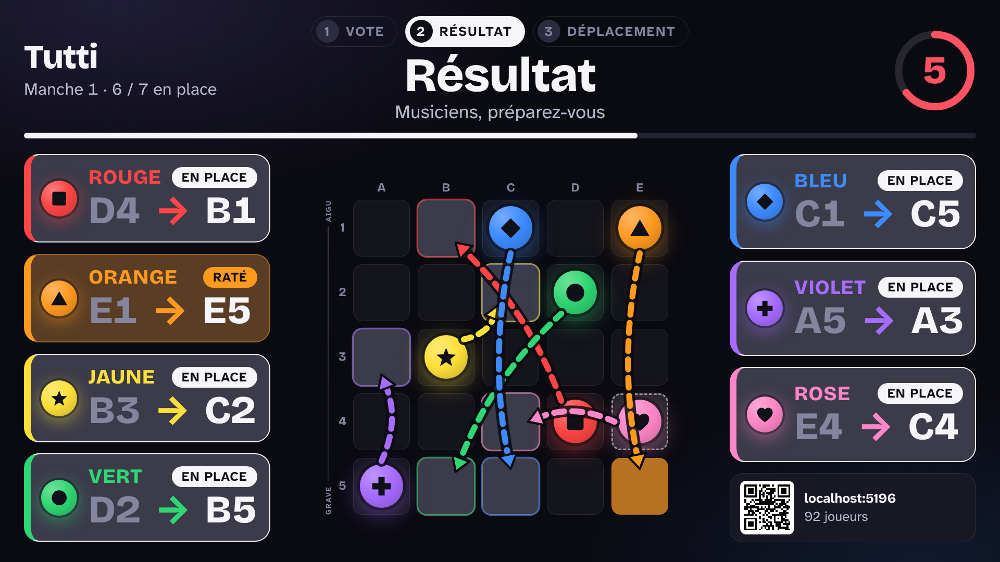
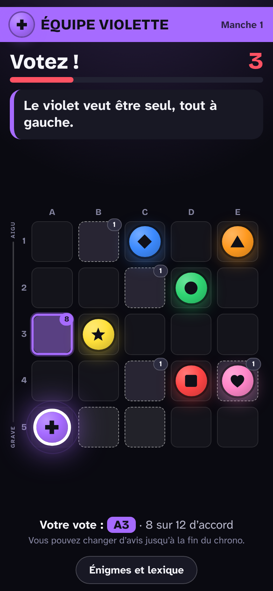
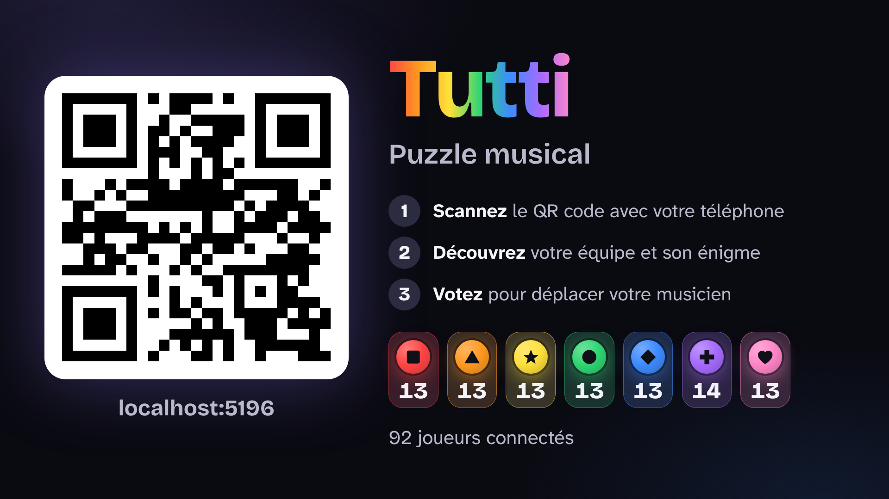
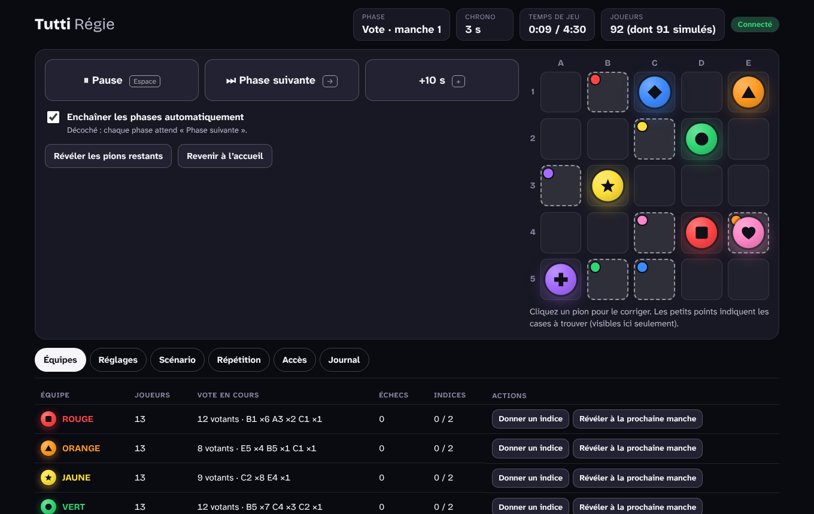

# Tutti — Puzzle musical

Une performance musicale où **le public déplace les musiciens**. Sur scène, une grille de 5 × 5 cases et
7 musiciens, chacun d'une couleur. Dans la salle, le public scanne un QR code, rejoint une équipe et vote
sur son téléphone pour envoyer « son » musicien sur la bonne case, à l'aide d'une énigme. À chaque
déplacement, la musique change. Quand la figure est reconstituée : *tutti !*



| Le téléphone du public | Le grand écran à l'accueil | La régie |
|---|---|---|
|  |  |  |

- **Rien à installer** pour le public : une page web, sans compte, sans donnée personnelle.
- **Trois écrans** : le téléphone (`/`), le grand écran (`/ecran`) et la régie (`/regie`).
- **Gratuit** : hébergement sur l'offre gratuite de Cloudflare.
- **Pensé pour la scène** : pause, correction à la main, musicien absent, joueurs simulés pour répéter,
  plan de secours sans Internet.

📖 Pour le jour du concert : **[guide de régie](docs/GUIDE-REGIE.md)**.
📐 Pour comprendre les choix : **[cadrage et conception](docs/RECOMMANDATION.md)**.

---

## Essayer sur son ordinateur

Il faut [Node.js](https://nodejs.org) 22 ou plus récent.

```bash
npm install
npm run dev
```

Puis ouvrir trois onglets :

| Adresse | Écran |
|---|---|
| <http://localhost:5173/regie> | La régie. À la première visite, on choisit son code. |
| <http://localhost:5173/ecran> | Le grand écran. |
| <http://localhost:5173/> | Le téléphone d'un spectateur. |

Pour voir une partie se jouer toute seule : dans la régie, onglet **Répétition**, ajouter 49 joueurs
simulés, puis **Lancer la partie**.

---

## Mettre en ligne gratuitement

Compter 10 minutes, une seule fois.

1. Créer un compte gratuit sur [cloudflare.com](https://dash.cloudflare.com/sign-up). Aucune carte bancaire n'est demandée.
2. Dans ce dossier, se connecter puis déployer :

   ```bash
   npx wrangler login
   npm run deploy
   ```

   À la première fois, Cloudflare demande de choisir un sous-domaine. La commande affiche ensuite l'adresse
   de l'application, de la forme `https://tutti.<sous-domaine>.workers.dev`.
3. Ouvrir `https://tutti.<sous-domaine>.workers.dev/regie` et **choisir le code de la régie**.
   À faire tout de suite : le premier qui ouvre cette page choisit le code.

Pour imposer le code plutôt que le choisir dans la page : `npx wrangler secret put REGIE_PIN`.

### Mise en ligne automatique depuis GitHub (facultatif)

Chaque modification arrivée sur la branche `main` peut être mise en ligne toute seule. Dans le dépôt GitHub,
*Settings → Secrets and variables → Actions*, ajouter deux secrets :

| Secret | Où le trouver |
|---|---|
| `CLOUDFLARE_API_TOKEN` | Tableau de bord Cloudflare → *My Profile → API Tokens* → modèle « Edit Cloudflare Workers » |
| `CLOUDFLARE_ACCOUNT_ID` | Tableau de bord Cloudflare → *Workers & Pages*, colonne de droite |

Tant que ces secrets n'existent pas, l'étape de mise en ligne est simplement ignorée.

---

## Préparer le concert

Tout se règle dans la régie, sans toucher au code.

| Besoin | Où |
|---|---|
| Changer une énigme, un indice, une case de départ ou à trouver | Onglet **Scénario**. Le vérificateur signale une énigme fausse ou des pions interchangeables. |
| Régler les durées, la durée visée, les options | Onglet **Réglages** (modifiable pendant la partie). |
| Un musicien est absent | Onglet **Équipes**, case « Musicien absent ». |
| Répéter sans public | Onglet **Répétition** : joueurs simulés. |
| Garder une copie du scénario | Onglet **Scénario** → Exporter. Le fichier se réimporte ensuite. |

Le scénario livré est celui du concert : [`scenarios/concert.json`](scenarios/concert.json).

### Sans Internet dans la salle

L'application peut tourner sur l'ordinateur de régie :

```bash
npm run local
```

La commande affiche une adresse du type `http://192.168.1.20:8787`. Les appareils connectés au même réseau
Wi‑Fi que l'ordinateur peuvent l'ouvrir. Détails et limites dans le [guide de régie](docs/GUIDE-REGIE.md).

---

## Vérifier que tout fonctionne

```bash
npm run check        # vérification du code
npm test             # le moteur de jeu
npm run test:e2e     # des parties complètes, dans un vrai navigateur
```

Les tests de bout en bout ont besoin du navigateur de Playwright : `npx playwright install chromium`.

Ces tests tournent sur le moteur de Chrome. L'application est écrite pour les téléphones depuis iOS 15 et
Android 2020, mais Safari n'est pas testé automatiquement : avant le concert, essayer avec quelques vrais
téléphones, dont des iPhone.

### Test de charge

Simule une salle entière, avec des téléphones qui se mettent en veille en pleine partie :

```bash
npm run local                                               # dans un premier terminal
npm run test:charge -- --joueurs 150                        # dans un second
npm run test:charge -- --url https://tutti.<sous-domaine>.workers.dev --pin MONCODE
```

⚠️ Le test lance une vraie partie dans le salon : ne jamais le lancer pendant un concert.

---

## Comment c'est fait

| Dossier | Contenu |
|---|---|
| `src/shared/` | Le moteur de jeu : règles, énigmes, vérificateur, équipes. Des fonctions pures, testées sans réseau. |
| `src/server/` | Le serveur : un Durable Object Cloudflare (`GameRoom.ts`) qui garde la partie, gère les chronos et diffuse l'état. |
| `src/client/` | Les trois écrans, en Svelte 5. |
| `scenarios/` | Le scénario du concert. |
| `tests/` | Tests du moteur (`unit/`), de bout en bout (`e2e/`) et de charge (`charge/`). |

Trois principes tiennent l'ensemble :

- **Le serveur fait autorité.** Chronos, dépouillement et validation ne se font jamais sur un téléphone.
- **Les cases à trouver ne quittent jamais le serveur** (sauf vers la régie).
- **L'état complet est renvoyé à chaque changement** : un téléphone qui sort de veille est à jour tout de suite.

Technologies : TypeScript, [Svelte 5](https://svelte.dev), [Vite](https://vite.dev),
[Cloudflare Workers et Durable Objects](https://developers.cloudflare.com/durable-objects/),
[PartyServer](https://github.com/cloudflare/partykit).
